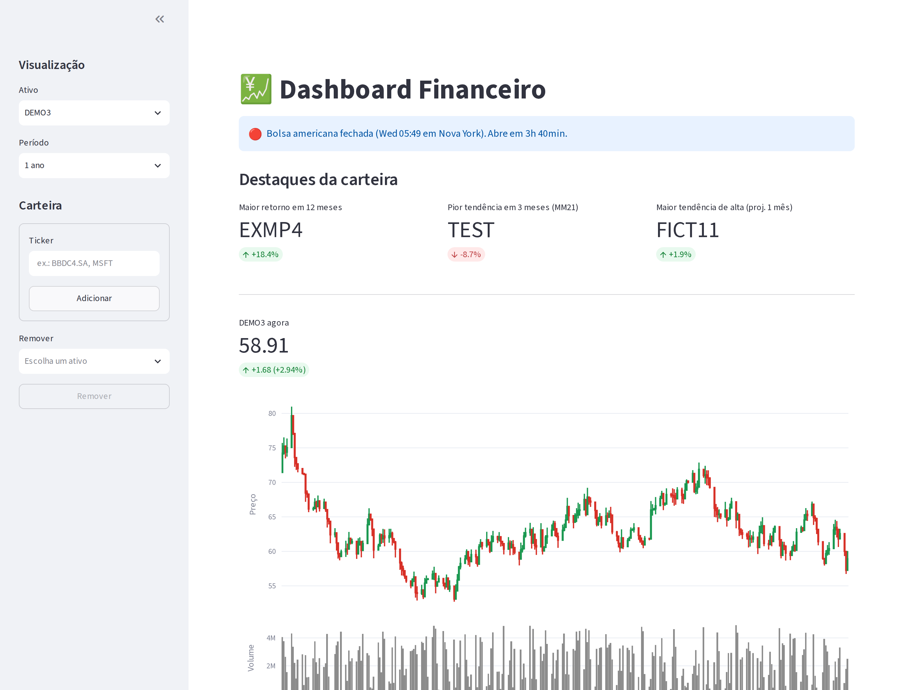

# 💹 Dashboard Financeiro

[](https://github.com/BigLeno/streamlitPipeline/actions/workflows/ci.yml)


Dashboard em Streamlit para acompanhar uma carteira de ações brasileiras e americanas: cotação,
gráfico de candles, indicadores técnicos, retornos mensais, correlação entre ativos e destaques da
carteira. O histórico fica salvo em banco e é atualizado de forma incremental.



<sub>Captura gerada pela CI com dados e tickers fictícios.</sub>

## Funcionalidades

- **Carteira:** adicione e remova tickers do Yahoo Finance (`PETR4.SA`, `AAPL`, índices como `^BVSP`...). Apelidos comuns como `IBOV` e `SP500` são convertidos para o código do Yahoo. O ticker é validado
  antes de entrar na carteira.
- **Histórico incremental:** na primeira vez baixa 5 anos; depois, só os dias que faltam, com alguns dias de
  sobreposição para pegar correções da fonte. Rodar de novo não duplica linhas.
- **Gráficos:** candles com volume, retorno acumulado, volatilidade anualizada, drawdown, médias móveis,
  RSI (Wilder) e MACD, retornos mensais (ano × mês) e correlação dos retornos diários.
- **Destaques da carteira:** maior retorno em 12 meses, pior tendência em 3 meses pela média móvel de 21
  dias e maior tendência de alta, projetada a partir de uma regressão no log do preço (comparável entre
  ativos de preços diferentes).
- **Tendência do dia:** para o ativo selecionado, mostra se o dia caminha para fechar em alta, em baixa ou
  estável (variação contra o fechamento anterior, conforme o horário da B3 ou da bolsa americana).
- **Cotação ao vivo:** a cotação e o status do pregão se atualizam sozinhos a cada minuto, sem recarregar
  os gráficos.
- **Explicações:** todo card tem um ícone de ajuda, e cada gráfico mostra uma leitura do momento com os números
  do ativo (por exemplo, o drawdown máximo e quando ocorreu) e um parágrafo de como interpretar o indicador.
- **Pregão americano:** indica se a NYSE/Nasdaq está aberta e quanto falta para abrir ou fechar.

## Arquitetura

```
streamlit_app.py        # interface (Streamlit + Plotly)
dashboard/
├── market_data.py      # Yahoo Finance via yfinance e uma fonte sintética para demo e testes
├── storage.py          # carteira e histórico com SQLAlchemy (SQLite por padrão)
├── sync.py             # atualização incremental do histórico
├── indicators.py       # indicadores técnicos (funções puras sobre séries do pandas)
├── highlights.py       # destaques da carteira
└── market_hours.py     # horário do pregão americano
```

Os cálculos não dependem da interface, da rede nem do banco, então são testados isoladamente com
séries sintéticas. A interface é testada com o `AppTest` do Streamlit, rodando o app inteiro com a fonte
sintética.

## Como rodar

### Com Docker (recomendado)

```bash
git clone https://github.com/BigLeno/streamlitPipeline.git
cd streamlitPipeline
docker compose up --build      # app + PostgreSQL em http://localhost:8501
```

O `docker-compose.yml` sobe o app e um PostgreSQL com healthcheck; o app só inicia depois que o banco
está pronto. A imagem roda com usuário sem privilégios e tem healthcheck próprio. Também é publicada no
GitHub Container Registry a cada merge na `main`:

```bash
docker run -p 8501:8501 ghcr.io/bigleno/streamlitpipeline:latest
```

### Sem Docker

```bash
git clone https://github.com/BigLeno/streamlitPipeline.git
cd streamlitPipeline
python -m venv .venv && source .venv/bin/activate
pip install -r requirements.txt
streamlit run streamlit_app.py
```

Para explorar sem internet, use dados sintéticos: `MARKET_DATA=fake streamlit run streamlit_app.py`.

| Variável | Padrão | Descrição |
| --- | --- | --- |
| `MARKET_DATA` | `yahoo` | `yahoo` (dados reais) ou `fake` (sintéticos) |
| `DATABASE_URL` | `sqlite:///data/dashboard.db` | Qualquer URL do SQLAlchemy, por exemplo PostgreSQL |
| `DEFAULT_TICKERS` | `^BVSP,PETR4.SA,VALE3.SA,ITUB4.SA,AAPL` | Carteira inicial quando o banco está vazio |
| `DEFAULT_SELECTED` | `^BVSP` | Ativo selecionado ao abrir o app (Ibovespa) |

O app não precisa de Chrome nem de chave de API, então pode ser publicado direto no
[Streamlit Community Cloud](https://streamlit.io/cloud).

## Testes

```bash
pip install -r requirements-dev.txt
ruff check .
python -m unittest -v
```

## CI/CD

O workflow do GitHub Actions roda a cada pull request e a cada merge:

| Etapa | O que faz |
| --- | --- |
| `test` | Lint (ruff) e testes em Python 3.10, 3.12 e 3.13 |
| `test (PostgreSQL)` | Testes do banco contra um PostgreSQL real, em container de serviço |
| `docker` | Lint do Dockerfile (hadolint), build com cache, sobe o container e espera o healthcheck, confere que não roda como root e gera a captura de tela a partir dele |
| publicação | Na `main`, envia a imagem ao GitHub Container Registry com as tags `latest` e `sha-<commit>` |

## Limitações

- Os dados do Yahoo Finance têm atraso e podem falhar sem aviso; o app mostra o último histórico salvo.
- O horário do pregão não considera feriados.
- Os destaques são estatística descritiva, não recomendação de investimento.
